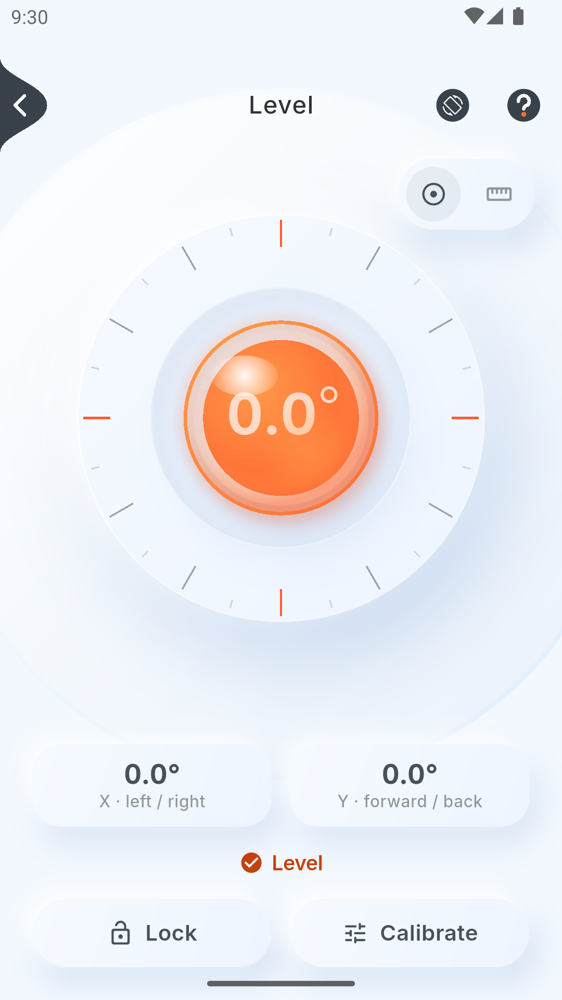
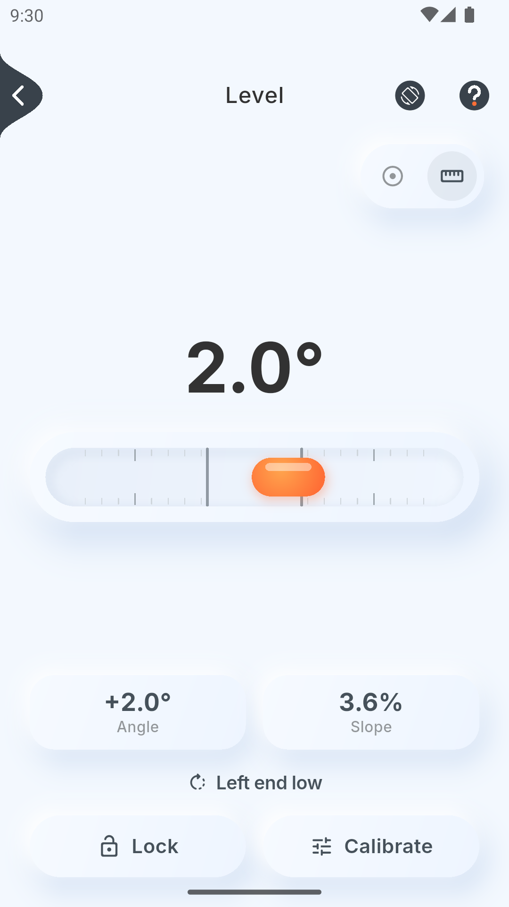
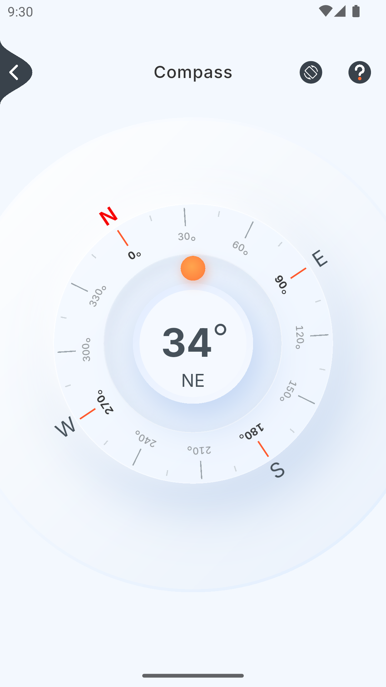
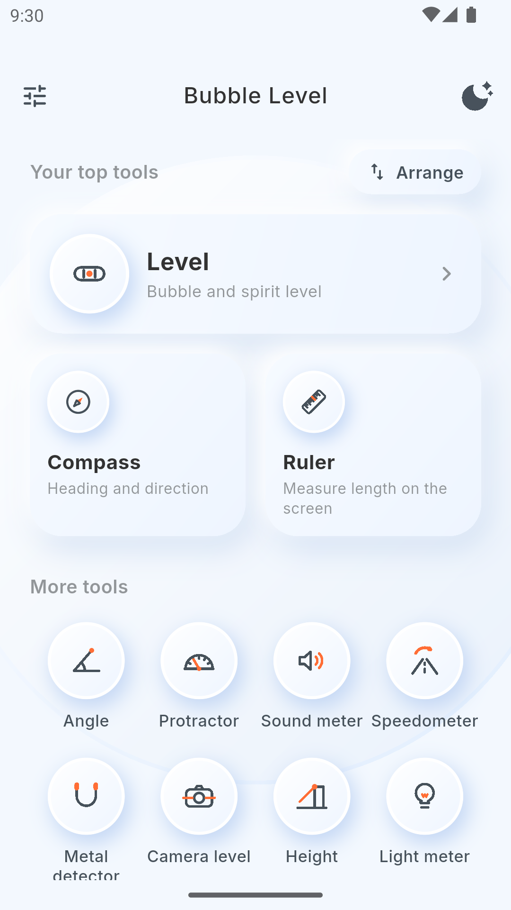

# Bubble Level & Angle Finder

Fifteen tools from your phone's sensors, in one free app with no
ads, no tracking and no internet permission. Built with Flutter, in 12
languages, light and dark.

**[Download the latest APK](https://github.com/aasifashraf/bubble_level/releases/latest)**
(Android 7.0 or newer). Most phones need the `arm64-v8a` file; older 32 bit
phones need `armeabi-v7a`. To get updates automatically, add this repo to
[Obtainium](https://github.com/ImranR98/Obtainium).

<p>
  
  
  
  
</p>

## Tools

The phone's sensors drive fifteen tools (thirteen on iPhone, which has no
Light meter or Tracker check), all drawn in one soft, full-screen dial design:

- **Level:** a bubble level when the phone lies flat, and a spirit level with
  a tilting water line when it stands on an edge. It shows the X
  (left/right) and Y (forward/back) tilt and says in words which side is
  high. A switch changes the dial for classic spirit-level tubes. Includes
  Hold, one-tap calibration and a chime when level.
- **Angle:** the angle from the Earth, or tap **Set zero** and measure how far
  the phone has moved since.
- **Compass:** tilt-compensated magnetic heading, with N/E/S/W, the direction
  under the number and a warning when nearby metal disturbs it.
- **Protractor:** drag two handles along an object's edges to read its angle.
- **Ruler:** measure small objects on the screen in mm, cm or inches, after a
  one-time calibration with a bank card, a ruler or the screen size. Turn on
  width for two more lines across, and it shows length × width and the area.
  Each finger moves its own line, so one can hold the object while another
  drags.
- **Metal detector:** magnetic field strength and change from a baseline, with
  a beep that speeds up as metal gets closer.
- **Vibration meter:** how hard a machine shakes (m/s²) and how fast it
  turns (hertz and RPM, from a spectrum of the accelerometer).
- **Sound meter:** noise in decibels (approx.), with average, maximum and a
  hearing warning; sound is measured, never recorded.
- **Light meter** (Android): brightness in lux and foot-candles.
- **Altimeter:** air pressure, approximate altitude, and height from a zero.
- **Height:** the height of a tree or building and the distance to it, by
  aiming the phone's top edge at its base and top (or typing the distance).
- **Camera level:** true level and plumb lines and the phone's own lines over
  the camera's picture; freeze it and drag a line onto an edge to read how
  far that edge is off level (the camera is never recorded).
- **G-force:** braking, speeding up and cornering in g for a phone in a car
  mount, with peaks.
- **Speedometer:** GPS speed on a dashboard view, trip distance, top and
  average speed, altitude and coordinates (location only while open).
- **Tracker check** (Android): Bluetooth trackers near you that are away from
  their owners (AirTag, Galaxy SmartTag, Tile, Chipolo, Find Hub tags), on
  rings by how close they are, and a warning when one is heard at 3 places
  over 30 minutes or more on a walk or drive. It helps you find the tracker,
  and its car check points to the Metal detector for GPS boxes with a SIM
  card, which no phone can hear.

Every tool has a short "How to use" guide. The app supports light and dark
themes, degrees or percent slope, a home screen with the most popular
tools first that you can arrange (your top three on cards), and sounds that
follow the phone's silent mode. It works on phones and tablets in portrait and
landscape.

## Privacy and permissions

The app has no internet permission, no ads, no analytics and no account.
Readings stay on the phone; settings and calibrations are saved on the phone
only. Each permission is asked only when you open the tool that needs it,
after a short explanation, and is used only while that tool is on screen:

| Permission | Used by | What for |
|---|---|---|
| Location | Speedometer, Tracker check | GPS speed, distance and altitude; places passed while checking for trackers |
| Nearby devices (Bluetooth) | Tracker check | Hearing item trackers; it never connects to them |
| Microphone | Sound meter | Noise level; sound is measured, never recorded |
| Camera | Camera level | The picture under the level lines; never recorded or saved |

The GitHub and F-Droid build (`foss`) contains no Google libraries at all:
GPS uses Android's own location service. Full details are in the
[privacy policy](docs/privacy-policy.html).

## How it works

- **Sensor fusion:** the gyroscope rotates the gravity estimate (smooth and
  fast), and the accelerometer slowly corrects it (no drift). Devices without
  a gyroscope fall back to a low-pass filter.
- **Missing sensors:** a native check at launch marks tools the phone can't
  run (no magnetometer or barometer) on the home screen and explains why. A
  sensor that never reports gets a clear message after a few seconds. The
  vibration meter falls back to the accelerometer when there is no
  linear-acceleration sensor.
- **Rotation aware:** a small native channel reports the UI rotation, so the
  sensor axes always match the screen, including on tablets and foldables.
- **Battery friendly:** sensors stop while the app is in the background, and
  only the open tool follows them.

## Project structure

```text
lib/
  domain/          pure math and models: angles, filters, readings, status
  data/
    services/      sensors_plus streams, native channels (display
                   rotation, sensor availability, GPS, light), camera,
                   microphone, sounds
    repositories/  orientation (fusion), settings (shared_preferences)
  ui/
    core/          theme tokens, dial and tube painters, full-screen frame,
                   help sheets, formatting
    features/      level, angle, compass, protractor, ruler, metal,
                   vibration, sound, light, altimeter, height, camera,
                   g_force, speed, settings (view models + views)
    home/          home screen: top tools, the grid, the Arrange sheet
test/              domain, view-model and app-flow tests
```

The UI follows MVVM: views listen to `ChangeNotifier` view models, which read
the repositories.

## Build it yourself

You need Flutter 3.47 or newer (Dart 3.13) and the Android SDK.

```powershell
flutter pub get
flutter run --flavor foss    # on a connected Android phone or emulator
flutter test                 # unit, view-model and widget tests
flutter build apk --release --flavor foss --split-per-abi  # installable APKs
```

Android builds need `--flavor`:

- `foss`: free software only, no Google libraries. Used for GitHub releases
  and F-Droid. Shows a small GitHub Sponsors card at the bottom of home.
- `play`: for Google Play, with Play's in-app review card and no Sponsors
  card.

Without `android/key.properties`, release builds are signed with the debug
key, which is fine for trying it on your own phone. iOS builds without a
flavour; it hasn't been released or tested on an iPhone yet.

## Feedback

Found a wrong reading, a bug or a translation mistake? Please
[open an issue](https://github.com/aasifashraf/bubble_level/issues) with your
phone model and Android version. Ideas for tools are welcome too, as long as
a phone's sensors can measure them honestly.

## Support

The app is free, with no ads and nothing locked. If it helps you, you can
support it on [GitHub Sponsors](https://github.com/sponsors/aasifashraf).

## Licence

GPL version 3 only: see [LICENSE](LICENSE).

## Credits

- Dial design based on the community "compass UI" Figma design.
- [Inter](https://github.com/rsms/inter) font, SIL Open Font License 1.1
  (`assets/fonts/Inter-OFL.txt`).
